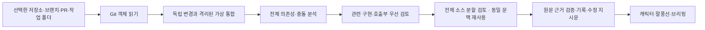

# 구조와 검토 범위

## 모듈

- `review_source`, `review_parallel`, `review_catalog`: 전체 대상 목록, 파일 수집, worktree, 가상 병합
- `review_analysis`, `review_context`, `review_evidence`, `review_batches`: 전체 정적 분석, 문맥 수집, 원문과 Python 호출 근거 검사, 소스 분할 전달
- `review_followup`, `review_changes`, `review_authors`: 수정 재확인, 변경 이력, 작성자와 수정자 구분
- `review_service`: SQLite 기록, 캐시, 분석 상태와 중복 알림 억제
- `codex_provider`: 기존 CLI 로그인, 빈 작업 디렉터리, 도구를 제한한 구조화 응답
- `review_ui`, `review_bubble`, `typing_label`: 브리핑과 작은 말풍선, 문장 줄바꿈
- `character`, `skin`, `portrait_motion`, `sprite_raster`: 캐릭터 입력, 팩, 동작과 표시 픽셀 캐시
- `review_watch`, `review_schedule`, `review_revision`: 변경 감지, 연속 푸시 병합, 재시도 간격, 실제 수집 상태의 완료 기록
- `review_runner`: 최대 4개 요청 동시 실행, 동일 입력 완료 결과의 로컬 캐시
- `review_process`: UI와 별도인 낮은 우선순위 분석 프로세스. 진행 안내만 전달하고 종료 시 Codex 하위 프로세스까지 정리
- `background`: UI 작업자 공통 코드
- `idle_chat`, `companion_weather`, `desktop_focus`: 선택형 한마디·날씨·전체화면 배려

이전 연구 자료 저장소, 논문 수집, 범용 상담·API 루프, 사용하지 않는 입력 화면은 새 제품에서 제외했습니다.

## 전체 소스 분할

Git 파일 목록은 전체를 읽습니다. 객체는 128개·약 8MB씩 읽되, 이것은 한 번의 읽기 단위이며 전체 수집 상한이 아닙니다. 큰 파일도 버리지 않습니다. 미커밋 내용에도 파일 수·총용량 상한을 적용하지 않습니다.

최신 변경과 관련 구현·호출부를 먼저 검토하고, 전체 소스는 파일 기준의 안정적인 묶음으로 나눠 원래 행 번호와 함께 전달합니다. 변경 비교 발췌가 달라져도 전체 소스 묶음은 흔들리지 않습니다. 긴 한 줄도 나눕니다. 같은 경로·동일 내용은 여러 ref에서 재사용하며, 내용이 다른 버전은 각각 포함합니다. 각 묶음에는 가능한 범위에서 의존·호출 문맥을 함께 넣습니다. 생성된 Python 의존성 잠금 파일은 선언을 읽고 해시·주석은 생략합니다.

브랜치 전체 목록과 코드 전체 탐색은 하나의 AI 요청에 전부 넣는다는 뜻이 아닙니다. 한 요청에는 최대 약 120,000자 소스와 관련 문맥을 묶고, 최대 4개를 동시에 실행합니다. 이는 전체 파일 수 제한이 아닙니다. 요청 수는 소스 크기에 따라 늘어납니다. 완료 표시는 모든 계획된 묶음이 성공하고 읽기 누락이 없을 때만 설정합니다. AI가 모든 버그를 찾는다는 보장은 아닙니다.

## 의도적으로 읽지 않는 항목

Git 내부 데이터, 가상환경, 외부 vendor·node_modules, 빌드 결과, 캐시, 바이너리, 민감 파일명과 알려진 키 패턴은 검토 대상에서 제외합니다. symlink·submodule의 외부 내용을 따라가지 않습니다. `.gitignore`에 의해 무시되는 untracked 파일과 저장 전 편집기 내용도 수집하지 않습니다.

Python AST와 JS/TS 정적 상대경로 import를 분석합니다. 다른 지원 언어는 AI 검토에 포함되며, 동적 로딩·별칭 해석·실제 실행 동작은 완전하게 증명하지 않습니다. 충돌 파일은 가상 통합본의 AST 검사에서 제외하고 각 변경 원문으로 다룹니다.

## 안전한 작업 경계

대상 코드를 checkout·실행하지 않습니다. 사용자 작업트리·index·브랜치를 수정하지 않고, 임시 Git 객체 공간에만 가상 통합을 만듭니다. 외부 diff·hook·filter·merge driver는 실행하지 않습니다. Codex 결과는 실제 원문의 행과 인용을 대조합니다.

문제 상세에서 요청하면 GitHub Actions를 관련 커밋의 SHA로 조회합니다. 코드를 비교해 확인한 해결 상태와 기존 실행의 결과를 표시합니다. 가상 통합본과 미커밋 코드는 미실행으로 표시합니다.

## 재시도와 로컬 캐시

새로 발견한 문제는 기존 이슈의 수정 재확인 전에 브리핑에 기록합니다. 수정 재확인에서는 한 스냅샷의 의존성과 소스 해시를 재사용하고, 근거 파일과 직접 연결된 코드가 바뀐 문제를 비교합니다. 확인 완료 응답은 `followup-cache`에서 같은 입력에 재사용합니다. 시간 초과가 발생한 묶음은 개별 항목으로 나눕니다.

완료한 응답은 `.data/code/review-cache`에 저장합니다. 변경 비교는 커밋·PR·diff가 같은 요청을 재사용합니다. 전체 소스 묶음은 코드와 문서를 별도로 구성하고, 묶음의 내용·관련 의존 파일·저장소 루트의 요구사항 문서·검토 규칙을 기준으로 재사용합니다. 캐시는 모델과 지침에도 연결되며 7일간 사용합니다. 재사용한 응답의 근거도 현재 원문과 대조합니다.

한 요청이 시간 초과되면 다른 검토를 진행한 뒤 해당 요청을 한 번 재시도합니다. 인증이나 사용 한도 오류가 나면 완료한 요청까지 저장합니다. 캐시 폴더는 앱이 종료된 상태에서 삭제할 수 있습니다.

## 연속 변경 자동 점검

Git/PR 메타데이터 확인은 분석 중에도 계속합니다. 미커밋 포함을 켠 로컬 저장소는 주기적으로 저장된 변경도 확인합니다. 마지막으로 발견한 변경 후 90초가 지나면 실행하되 저장소별 자동 분석 시작 간격은 최소 5분입니다. 변경이 계속되면 최초 대기부터 최대 10분까지 모읍니다. 다른 분석이 진행 중이면 대기가 더 길어질 수 있습니다. 다음 대상으로 최신 상태 하나를 보관합니다.

완료 시 실제 수집한 브랜치·PR 상태를 기록합니다. 그 이후에 들어온 변경을 분석 완료로 처리하지 않습니다. 실제 수집 상태를 전달할 수 없는 범위는 시작 전 관측 상태만 기록해 보수적으로 다시 확인합니다. 수동 ‘지금 분석’은 대기 조건을 우회합니다. 실패 시 자동 재시도는 5·10·20·30분으로 늦추며, 성공 시 초기화합니다. 마지막 시작과 재시도 시각은 로컬 watch-state.json에 보관합니다. 자동 점검을 끄거나 연결을 해제하면 대기 대상에서도 제외합니다.
