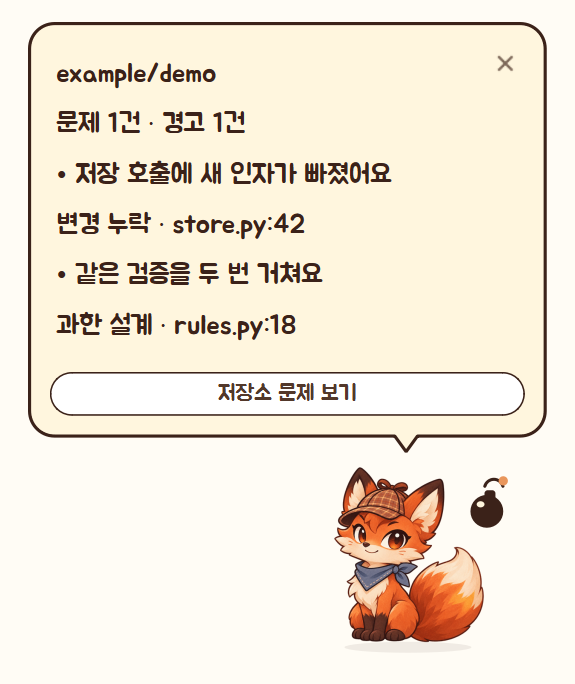

# 불여우 탐정 사용설명서

저장소 연결하고, 볼 브랜치를 고르고, 불여우한테 맡기면 됩니다. 문제가 나오면 **말풍선 → 브리핑 → 수정 지시문** 순서로 보면 돼요.

## 1. 어디를 볼지 정하기

1. [Windows 설치 파일](https://github.com/ArialHanho/who-is-disaster/releases/latest)을 받아 실행합니다. Git 2.38 이상과 Codex CLI를 설치하고 `codex login`으로 로그인합니다. 연결 상태는 **설정 → 로그인 연결 확인**에서 볼 수 있습니다.
2. 캐릭터 우클릭 → **비서 열기 → 저장소**로 갑니다. **GitHub 연결**은 내 저장소나 접근 가능한 조직 저장소를 여러 개 고를 수 있습니다. 작업 중인 Git 폴더는 **로컬 폴더**로 연결하거나 캐릭터 위에 끌어놓습니다. 주소를 알고 있으면 **주소 입력**도 됩니다.
3. **브랜치 보기**에서 볼 브랜치만 체크합니다. 새 브랜치를 계속 보고 싶을 때 **새 브랜치도 자동 포함**을 켜세요. 기준 브랜치는 비교에 사용합니다.
4. **열린 PR 자동 포함**을 켜면 선택 범위에서 열린 PR도 확인합니다. 같은 저장소에서 체크되지 않은 브랜치의 PR은 분석 대상에서 빠집니다. 아직 커밋 안 한 코드도 보려면 로컬 연결의 **등록된 작업 폴더의 미커밋 변경 포함**을 켭니다.

연결을 끊을 때는 **저장소 → 설정 → 연결 해제**를 누릅니다. 이 비서에 저장된 연결과 분석 기록이 제거됩니다.

## 2. 문제를 보고 고치기

**지금 분석**을 누르면 연결한 범위를 살펴봅니다. 저장소 설정에서 **커밋·푸시 변경을 모아서 자동 점검**을 켜면 연속 푸시를 모아서 봅니다. 미커밋 변경을 포함한 로컬 연결에서는 파일을 저장할 때도 점검 대상으로 잡습니다.

- **말풍선** — 문제·경고 건수와 먼저 볼 두 항목의 제목, 유형, 파일 위치를 보여줍니다. 타이핑 중 글을 누르면 바로 읽을 수 있습니다.
- **브리핑** — 새 문제부터 보세요. 과한 설계, 순환, 변경 누락 같은 분류를 누르면 필요한 항목으로 좁힐 수 있습니다.
- **AI 수정 지시문 복사** — 문제 카드를 펼친 뒤 복사해 현재 작업하는 AI에 전달합니다. 수정 후 **수정됐는지 확인**을 누르면 현재 코드와 비교합니다.
- 여러 문제를 함께 고치려면 카드 왼쪽에 체크하세요. 같은 필터에서 페이지를 넘겨도 선택이 유지됩니다. **지시문 보기**에서 내용을 확인하고 **복사**를 누르면 됩니다. **수정 확인**도 체크한 항목에 적용됩니다.
- **GitHub 검사 결과 보기** — 문제나 수정에 해당하는 커밋의 Actions 실행을 가져옵니다. 실패한 실행은 실패 단계와 테스트 수정 지시문을 확인할 수 있습니다. 가상 통합본과 미커밋 코드는 미실행으로 표시됩니다.

## 3. 불여우랑 같이 쓰기

불여우는 대기 중에 눈을 깜박이고, 분석을 찾기·생각·기록 자세로 보여줍니다. 경고가 생기면 놀라고 오래 쉬면 꼬리를 말고 잠듭니다.

| 하고 싶은 것 | 조작 |
|---|---|
| 말풍선 열기 | 한 번 클릭 |
| 토닥이기 | 두 번 클릭하거나 길게 누르기 |
| 옮기기 | 드래그 |
| 크기 바꾸기 | 마우스 휠 |
| 캐릭터 바꾸기 | 우클릭 → **캐릭터 바꾸기** |
| 다시 보이게 하기 | 화면 가장자리 **비서 열기** 탭 또는 Windows 트레이 |

한마디나 날씨가 필요하면 우클릭 메뉴의 **기타 연결**에서 켜세요. **1시간 조용히**와 **오늘은 조용히**도 우클릭 메뉴에 있습니다. 직접 만든 캐릭터를 쓰고 싶다면 [캐릭터 제작 안내](characters.md)를 보면 됩니다.

## 막힐 때

- **Codex가 연결 안 됐어요** — 터미널에서 `codex login status`를 확인합니다. 설정에서 모델 칸을 비우면 CLI 기본 모델을 사용합니다.
- **Actions 실행 결과가 없어요** — 해당 커밋에서 실행된 워크플로가 있는지 GitHub에서 확인합니다.
- **분석이 미완료예요** — 브리핑의 수집·AI 오류 안내를 확인한 뒤 다시 실행합니다.

[업데이트·백업](maintenance.md) · [GitHub로 돌아가기](../README.md)

상업적으로 사용하려면 ArialHanho의 사전 서면 허락이 필요합니다. [라이선스와 사용 문의](../NOTICE.txt)
